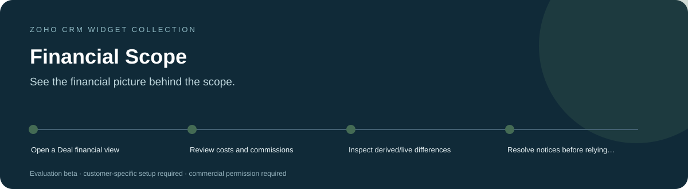
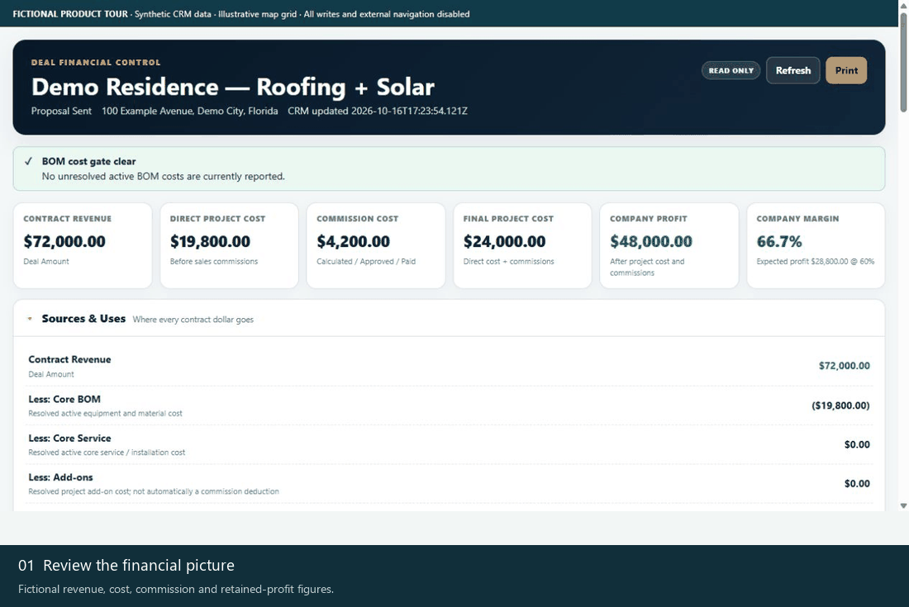
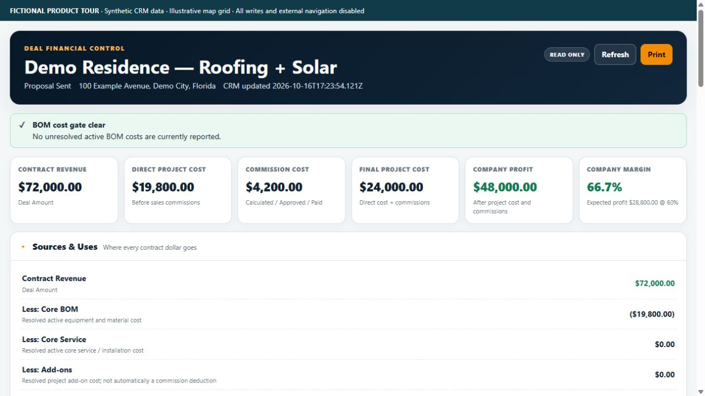
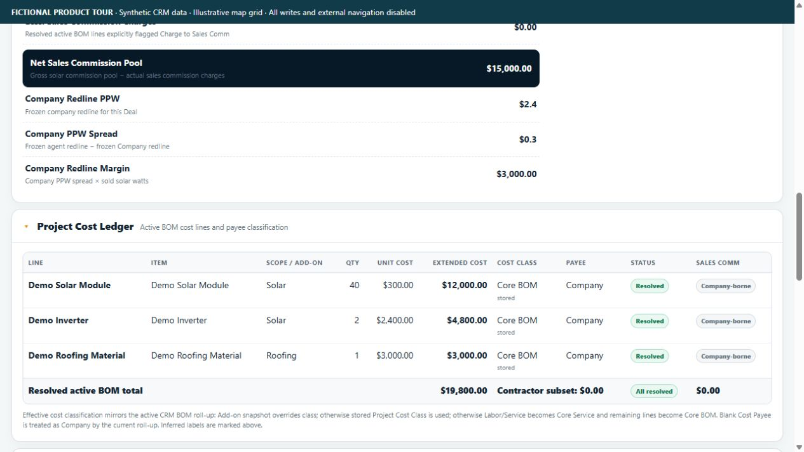
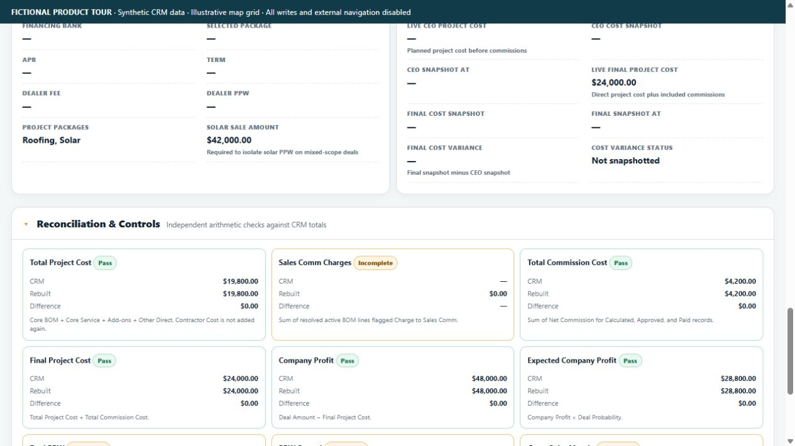
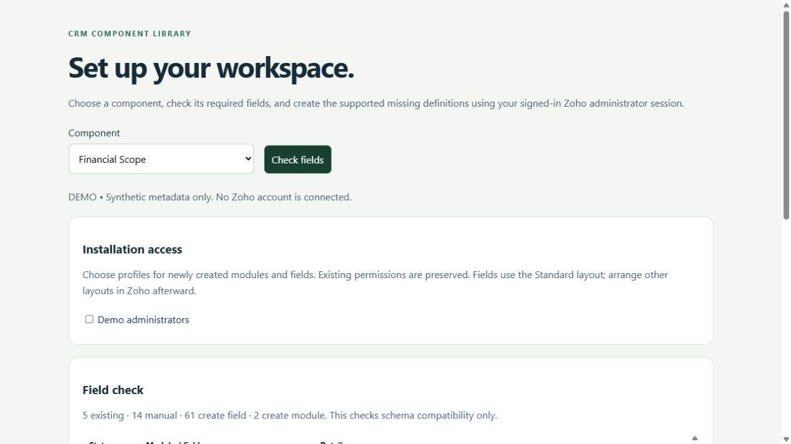

<h1 align="center">Financial Scope for Zoho CRM</h1>

<strong>See the financial picture behind the scope.</strong> A Deal review workspace that brings bill-of-materials costs, commission context and project-profit calculations into a single operational financial view.

Tested &amp; In Development / Pre-Release · Development showcase and fictional-data tours

> **Tested & In Development / Pre-Release.** Testing covers documented development checks only. Production readiness and customer-specific acceptance remain pending.

> [!IMPORTANT]
> **Showcase only.** This public repository contains product information and fictional demonstration media. It provides no software source, installable packages, free beta downloads or software license. Release availability remains pending; any future deployment scope will be agreed privately. Product validation and the limitations below still apply.

[Discuss a commercial installation](https://github.com/RawPowered/Zoho-Financial-Scope/issues/new?template=commercial-inquiry.yml) · [Deployment model](DEPLOYMENT.md) · [Commercial terms overview](COMMERCIAL.md)

## A focused workspace

Owners, project managers and finance/operations staff reviewing the economics of a Deal.

| Capability | What it helps with |
| --- | --- |
| **Sources and uses** | Review contract value, project costs and the resulting profit context. |
| **Traceable components** | Inspect BOM and included commission rows beside live and derived totals. |
| **Visible uncertainty** | Surface missing costs, snapshot differences and reconciliation notices instead of treating every total as final. |

## Product tour

These captures show the actual widget running against an isolated fictional-data adapter. No customer account, real person, customer branding or production credential is used. CRM writes and outbound navigation are blocked. Map backgrounds are illustrative grids; required third-party attribution is retained.

### Watch the workflow

The animation is a sequence of actual interface states, held for readability. It is not a recording of a live customer installation.

### Start with the workspace

Fictional revenue, cost, commission and retained-profit figures.

### Follow the next actions

<table><tr><td width="50%"><strong>Trace the project costs</strong>
Inspect the BOM rows, unit costs and payee classification.
</td><td width="50%"><strong>Compare CRM and rebuilt totals</strong>
Reconciliation shows both passing and incomplete checks.
</td></tr></table>

### Prepare the account deliberately

A separately licensed Schema Setup companion can be scoped to this product. It reads field metadata, identifies compatible existing definitions, and distinguishes missing definitions from manual steps. A field plan does not certify that functions, workflows or permissions are complete.

All records and sample labels are fictional. Preview tooling and installable software are not distributed through this public showcase. Commercial deployment still requires the documented account-specific acceptance checks.

## Commercial deployment

Licensed widget packages are supplied privately for the agreed customer organization. An authorized administrator installs them directly inside Zoho CRM using **Zoho internal hosting**, sets the supplied entry page and attaches the intended CRM placement. A Deal record button or related-list widget.

Schema, access profiles, workflows and service connections are reviewed for the licensed installation. A showcase screenshot does not certify compatibility or complete those steps. WordPress integration, where licensed, runs on the customer's live WordPress host and is configured separately. [How the platforms fit together](DEPLOYMENT.md).

## Data access and responsibilities

**Reads:** The active Deal, related Deal_BOM_Items and Sales_Commissions, including configured cost, commission and financial snapshot fields.

**Writes:** The financial widget loads and presents CRM data; it does not implement CRM record mutation. Its Schema Setup companion can create supported definitions after explicit administrator review.

**External services:** Zoho's signed-in SDK. Currency formatting in this build uses USD/en-US conventions.

## Current product boundaries

- Derived values are operational estimates; unresolved costs and stale snapshots can change the picture.
- USD/en-US formatting and business-specific financial policy need review before deployment.
- This widget does not replace accounting records, audited statements or a compensation agreement.

Status: **Tested & In Development / Pre-Release**. Account-specific acceptance is required before production activation. Credentials and customer data are configured privately in the customer environment.

## Commercial availability

Request licensing, installation, account mapping or support through a [commercial inquiry](https://github.com/RawPowered/Zoho-Financial-Scope/issues/new?template=commercial-inquiry.yml). Include only a general use case; public issues must not contain customer records, account IDs, secrets or confidential details. Pricing, permitted organizations/users, delivery scope and support terms are agreed privately. This page does not collect payment or grant permission to use the software.

## Explore the collection

[Widget collection](https://github.com/RawPowered/Zoho-CRM-Widgets) · [Automation overview](https://github.com/RawPowered/Zoho-CRM-Automations) · [PowerPortals](https://github.com/RawPowered/PowerPortals-Showcase)

- [Service Map](https://github.com/RawPowered/Zoho-Service-Map)
- [Get Directions](https://github.com/RawPowered/Zoho-Get-Directions)
- [Service Map Dashboard](https://github.com/RawPowered/Zoho-Service-Map-Dashboard)
- [CEO Pipeline](https://github.com/RawPowered/Zoho-CEO-Pipeline)
- [Project Scoper](https://github.com/RawPowered/Zoho-Project-Scoper)
- [Parts and Scope Builder](https://github.com/RawPowered/Zoho-Parts-and-Scope-Builder)
- [Project Task Builder](https://github.com/RawPowered/Zoho-Project-Task-Builder)
